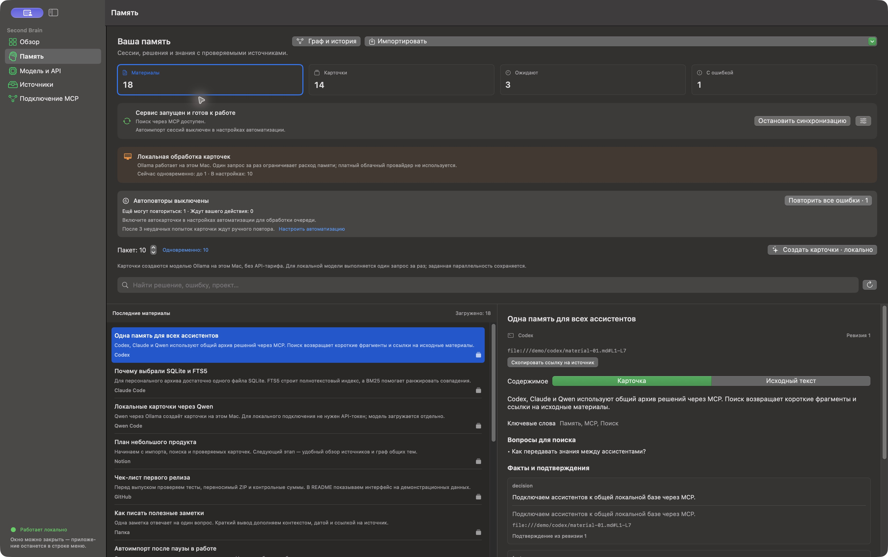
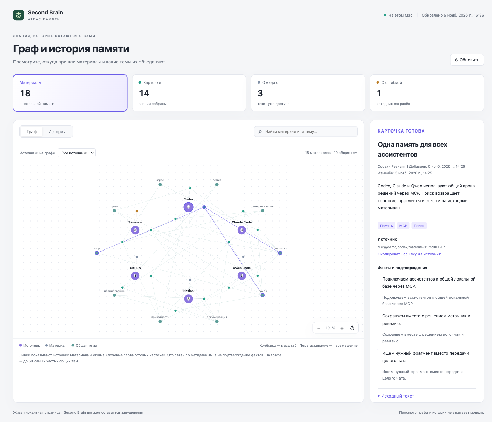
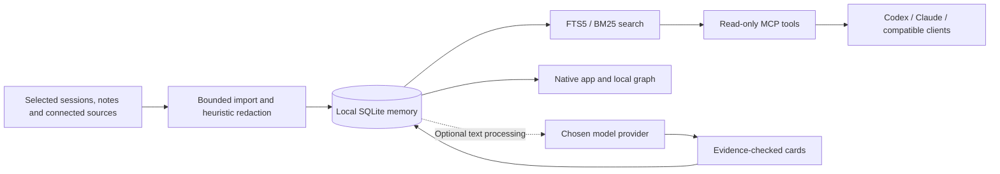

# Second Brain

**A shared, source-backed memory for AI assistants, stored on your Mac.**

**0.1.0 · macOS 14+ · Native SwiftUI app · MIT**

[English](#english) · [Русский](#russian) · [Documentation](docs/README.md) · [Changelog](CHANGELOG.md) · [Security](SECURITY.md)

<a id="english"></a>

## English

Second Brain turns selected assistant sessions, notes and connected sources into a
searchable local archive. Codex, Claude Code and compatible MCP clients can find
previous decisions, errors and useful context through the same memory.

The native macOS app manages sources, model credentials, imports and automation.
SQLite stores the memory; FTS5/BM25 performs local search. A model can optionally
create compact cards with evidence from the original material. The main interface
uses SwiftUI; the optional graph and history open as a local HTML page.

### Screenshots

The screenshots use synthetic materials and demo sources, with no personal
cards or credentials. The native interface is currently in Russian.

**Native macOS app — memory, cards and source evidence**



**Local memory graph — materials, sources and shared topics**



### Why use it?

- **Carry context between projects and assistants.** Connect clients to one MCP
  server instead of repeatedly copying old conversations.
- **Keep the evidence.** Results retain source references, timestamps and
  revisions so you can inspect where a remembered statement came from.
- **Search without inference costs.** Import and BM25 search do not require model
  calls. Card generation is optional and uses the provider you choose.
- **Control ingestion.** Select folders, pages, repositories and mailboxes; pause
  new imports while cached memory stays available.
- **Keep the stack small.** One SQLite database, a Python helper and a native app;
  no separate vector database or hosted memory service is required.

This is useful when working across many chats or projects. Compared with manual
copying, it offers shared search, citations and incremental imports. The tradeoff
is maintaining a local app and granting explicit source access. It does not
replace backups or a team's access-control system. It cannot guarantee that an
assistant calls MCP on every message or that a generated card is correct. The
published release uses lexical BM25 search. **Unreleased source builds** add
optional local semantic/hybrid retrieval through a separately selected installed
Ollama embedding model. It is off by default, downloads no weights and keeps BM25
available. Actual relevance improvement has not yet been verified with a real
model; see [search modes and limits](docs/user-guide.en.md#semantic-search).

**Unreleased evidence bundles** add exact source quotes with stable citation IDs,
current revisions, nullable source dates and a bounded JSON context budget. Codex
or Claude writes the answer from those quotes; retrieval does not generate an
answer or incur a paid model call. The native app previews the packet and refreshes
its permitted citations and support before explicit copying. See
[evidence workflow](docs/user-guide.en.md#evidence-bundles).

### Sources

| Source | Imported content | Scope |
| --- | --- | --- |
| Codex / Claude Code / Qwen Code | JSONL session text | Selected folders; Qwen imports after a quiet period |
| Notes | Markdown, TXT, JSONL | Selected folder; symlinks skipped |
| Apple Notes — unreleased | Note text from selected folders | macOS Automation permission; Notes open; protected notes and attachments skipped |
| Notion | Selected page text | Up to 100 pages; child pages selected separately |
| GitHub | Markdown, issue/PR titles and bodies, state and labels | Up to 20 repositories; no code, comments or diffs |
| Gmail / Yandex Mail | Inbox headers and text | App passwords; initial 30/90/365-day window or all history; whole messages over 1 MiB skipped |
| Outlook / Microsoft 365 — unreleased | Inbox headers and text | Microsoft OAuth device sign-in; registered Client ID; explicit import period |

**Source builds only:** Apple Notes and Outlook are not in the published `v0.1.0` ZIP. See the [source guide](docs/user-guide.en.md#apple-notes-source) and [Outlook registration guide](docs/outlook-setup.md#english).

**Unreleased source permissions:** a source's hand icon opens independent controls
for import, search in the app, MCP access, local model processing and external
model processing. Local folders and selected Apple Notes folders also support
exclusions with a preview. Existing settings keep their behavior; changing a
permission does not start a model. MCP access permits the requesting agent to
receive text, including when that agent uses a cloud model. See
[source permissions](docs/user-guide.en.md#source-permissions).

Large archives run in bounded passes and preserve their continuation state.
Remote imports are local snapshots: deleting something remotely does not
implicitly purge its imported copy.

### Install and launch

**Prebuilt application:** use `Second-Brain-0.1.0-macos-arm64.zip` from the
repository's **Releases → Assets**. It contains the native app and its Python
service. On an **Apple Silicon Mac with macOS 14+**, extract it, move
**Second Brain.app** to **Applications**, and open it. **Xcode, Python, uv and a
source checkout are not required on the recipient's Mac.** An Intel build is
not included in this asset.

The current package is **ad-hoc signed, without Developer ID or Apple
notarization**. macOS can block an app downloaded from the internet. If you trust
the release and have checked its checksum, use Apple's documented **System
Settings → Privacy & Security → Open Anyway** flow. Do not disable Gatekeeper.
See the [installation guide](docs/user-guide.en.md#2-requirements-and-installation)
and [release notes](docs/releases/0.1.0.md) for the package's limits.

The release starts with a separate local archive in
`~/Library/Application Support/Second Brain`. It does not include a maintainer's
memory, source connections or credentials, and does not automatically migrate a
source-build `.data` directory.

**Build from source (development):** this path requires Apple Command Line Tools
with **Swift 6+**, Python 3.11+, and
[uv](https://docs.astral.sh/uv/getting-started/installation/). Node.js is used for
development checks. In the checkout's root directory:

```sh
xcode-select --install
uv sync --frozen --group dev
./scripts/build-app.sh
open "Second Brain.app"
```

The development app uses this checkout and its `.venv`; keep both in place.
`./start.command` is another local launcher. To prepare the portable release
rather than a development app, see [releasing](docs/releasing.md).

### First-use guide

1. **Add a source.** Open **Sources → Add source**. Select session or notes
   folders, Notion/GitHub content, Gmail or Yandex Mail. Provider-specific
   instructions are in each form. Never paste credentials into a chat or issue.
2. **Choose scope.** For email, explicitly enable import and choose an initial
   period; the default is 30 days. Existing mail connections do not silently opt in.
3. **Import.** Use a source's import button or **Memory → Import**. A model is not
   required to populate and search the archive.
4. **Find context.** Search **Memory**. Counters filter materials, completed cards,
   pending records and errors. Scrolling loads more records; details show evidence.
5. **Optionally create cards.** In **Model and API**, choose a cloud provider
   (including Qwen API) with its token, or local Qwen through Ollama without a
   token. Save the model and test a small batch. Cloud processing sends text to
   that provider and may incur charges; local processing uses your Mac. Ollama
   and model weights are separate installs. A custom OpenAI-compatible API needs
   its HTTPS base URL (public by default), token and exact model ID; catalog
   loading is optional. **Unreleased source builds** add an explicit opt-in for a
   trusted corporate API on an internal network; the published `v0.1.0` ZIP does
   not include that option. See the [connection guide](docs/user-guide.en.md#4-models-and-cards)
   and [local Qwen setup](docs/user-guide.en.md#qwen-api-and-local-qwen).
6. **Set automation.** Session watching polls about every 30 seconds, using a
   completed-turn marker or 90 seconds of inactivity. Connected remote sources
   use the memory reconciliation schedule while the app runs.
7. **Control requests.** The batch limit caps materials per job; concurrency
   separately controls simultaneous card requests: any positive whole number,
   with a default of 10. Actual parallel work cannot exceed the current batch
   size. A failed card has two automatic retries after the first attempt, then
   waits for user action. A provider `429` pauses further card requests across
   the queue; recovery starts at one request at a time, without changing your
   saved concurrency. Import and MCP search remain available. See
   [provider recovery](docs/user-guide.en.md#provider-pauses-and-card-errors).
8. **Connect assistants.** In **MCP connection**, copy/register the server command
   in Codex/Claude. Ask the client to search Second Brain. See the
   [full MCP setup](docs/user-guide.en.md#mcp). Reconnect running MCP clients
   after updating the server.
9. **Pause safely.** Global synchronization pause stops automatic imports and
   card admission. Mailboxes have their own switches. Cached search and MCP stay
   available; already started model requests may finish.
10. **Inspect and maintain.** Open **Graph and history** to explore sources and
    shared card keywords. Back up SQLite consistently before upgrades. Removing
    a source removes its local materials, credentials and progress; originals
    in the connected service remain.

Closing the window leaves the app in the Dock and menu bar. Quitting stops its
helper and ingestion. An independently launched MCP server can read cached
memory without the app. See the [full English guide](docs/user-guide.en.md) for
setup details, limits, backups and troubleshooting.

### Architecture



The four original MCP tools are `search_memory`, `get_record`,
`get_context_brief`, and `get_sync_status`. Unreleased source builds add the
read-only `get_evidence_bundle` tool while preserving their required arguments.
They do not trigger imports or card generation. In unreleased builds,
`search_memory` accepts optional `mode=lexical|semantic|hybrid`; after explicit
embedding opt-in, semantic/hybrid requests can invoke only the local query
embedding model and report the mode actually used. More in the
[architecture guide](docs/architecture.en.md).

### Security and privacy

Credentials use macOS Keychain. Sources are accessed read-only. The HTTP helper
is loopback-only with Host/Origin checks and CSRF protection; known secret formats
are masked before indexing. Personal memory, local configuration, working notes
and development apps are excluded from the public source repository. Release ZIPs
are built separately; see the [artifact checks](docs/releasing.md#privacy-and-artifact-checks).

These are specific protections, **not a guarantee of complete security**:

- SQLite, its WAL and backups are not encrypted by the application.
- Cloud cards send text to the selected provider; local Ollama cards use a
  downloaded model on this Mac. MCP results can still be transmitted by the
  AI client using them.
- Connected projects share one memory without per-project permissions.
- These measures do not isolate data from a compromised same-user process.

Read [SECURITY](SECURITY.md) and the [threat model](docs/security.en.md) before
importing private material.

### Development and license

```sh
uv sync --frozen --group dev
uv run ruff check brain_settings tests scripts launch.py
uv run pytest --cov=brain_settings --cov-report=term-missing
node --test tests/test-model-utils.mjs tests/test-memory-atlas.mjs
swift run --package-path native SecondBrainCoreChecks
```

Tests use synthetic sources and fake credentials/transports. Swift checks use an
executable harness rather than XCTest. See [CONTRIBUTING](CONTRIBUTING.md),
[development](docs/development.md) and [releasing](docs/releasing.md).

Licensed under [MIT](LICENSE). Release notes: [CHANGELOG](CHANGELOG.md).
Community expectations: [Code of conduct](CODE_OF_CONDUCT.md).

---

<a id="russian"></a>

## Русский

**Second Brain — общая память для ИИ-ассистентов на вашем Mac.**

Приложение собирает выбранные сессии, заметки и подключённые источники в локальный
архив. Codex, Claude Code и другие MCP-клиенты находят в нём прошлые решения,
ошибки и полезный контекст со ссылками на исходные материалы.

Управление выполнено на SwiftUI: нативные окна macOS, значок в Dock и строке меню.
Материалы хранятся в SQLite, поиск работает через FTS5/BM25. При желании выбранная
модель создаёт краткие карточки с подтверждающими фрагментами. Граф и история
открываются отдельной локальной HTML-страницей.

### Скриншоты

На скриншотах — вымышленные материалы и демонстрационные источники, без личных
карточек и учётных данных.

**Нативное приложение macOS — память, карточки и подтверждающие фрагменты**


**Локальный граф памяти — материалы, источники и общие темы**


### Для чего это нужно и в чём преимущество

- **Контекст между чатами и проектами.** Разные ассистенты используют одну память;
  прошлые разговоры не нужно каждый раз переносить вручную.
- **Проверяемые источники.** У материалов есть ссылки, даты и ревизии.
- **Поиск без вызова модели.** Импорт и BM25 не требуют генерации; создание карточек
  через API включается отдельно и использует выбранного провайдера.
- **Управляемая область доступа.** Вы выбираете папки, страницы, репозитории и
  почту, а затем можете приостановить поступление новых данных.
- **Небольшой стек.** Для памяти не нужен отдельный векторный сервер или
  размещённый у стороннего сервиса архив.

По сравнению с ручным копированием истории вы получаете общий поиск, ссылки и
постепенный импорт. Взамен нужно поддерживать локальное приложение и осознанно
предоставлять доступ к источникам. Это не замена резервным копиям или командной
системе прав доступа. Приложение не гарантирует вызов MCP в каждом сообщении и
безошибочность карточек. Выпущенная версия использует лексический BM25.
**Неопубликованные исходники** добавляют локальные семантический и гибридный
режимы с отдельной установленной embedding-моделью Ollama. По умолчанию индекс
выключен, веса автоматически не загружаются, BM25 сохраняется. Улучшение качества
с настоящей моделью пока не подтверждено; см.
[режимы и ограничения](docs/user-guide.ru.md#semantic-search).

**Пакет доказательств — ещё не выпущено:** точные цитаты с устойчивыми ID,
текущими ревизиями, отдельно известными датами источника и ограниченным бюджетом
JSON-контекста. Codex или Claude составляет ответ по этим цитатам; поиск не
генерирует ответ и не вызывает платную модель. Приложение позволяет просмотреть
пакет и повторно проверяет разрешённые цитаты/подтверждения перед явным копированием.
В MCP добавлен пятый инструмент `get_evidence_bundle`,
четыре прежних сохраняют обязательные аргументы. См.
[работу с доказательствами](docs/user-guide.ru.md#evidence-bundles).

### Источники

| Источник | Что попадает в память | Область |
| --- | --- | --- |
| Codex / Claude Code / Qwen Code | Текст сессий JSONL | Выбранные папки; Qwen импортируется после паузы записи |
| Заметки | Markdown, TXT, JSONL | Выбранная папка; символические ссылки пропускаются |
| Apple Заметки — ещё не выпущено | Текст заметок выбранных папок | Разрешение «Автоматизация» macOS; Notes открыты; защищённые заметки и вложения пропускаются |
| Notion | Текст выбранных страниц | До 100 страниц; вложенные выбираются отдельно |
| GitHub | Markdown, заголовки и описания issues/PR, состояния и метки | До 20 репозиториев; без кода, комментариев и diff |
| Gmail / Яндекс Почта | Заголовки и текст входящих | Пароль приложения; 30/90/365 дней или вся история; письма больше 1 МиБ пропускаются |
| Outlook / Microsoft 365 — ещё не выпущено | Заголовки и текст входящих | Вход Microsoft по коду; зарегистрированный Client ID; явный выбор периода импорта |

**Только сборки из исходников:** Apple Заметок и Outlook ещё нет в опубликованном ZIP `v0.1.0`. См. [руководство источников](docs/user-guide.ru.md#apple-notes-source) и [регистрацию Outlook](docs/outlook-setup.md#russian).

**Разрешения источников — ещё не выпущено:** кнопка с рукой у источника открывает
независимые настройки импорта, поиска в приложении, MCP, локальной и внешней
модельной обработки. Для локальных путей и выбранных папок Apple Заметок доступны
исключения с предварительным просмотром последствий. Старые настройки сохраняют
своё поведение; разрешение само по себе не запускает модель. Доступ через MCP
передаёт текст запрашивающему агенту, в том числе облачному. Подробнее —
[разрешения источника](docs/user-guide.ru.md#source-permissions).

Большие архивы обрабатываются ограниченными пакетами с сохранением продолжения.
Удаление объекта в удалённом сервисе само по себе не удаляет локальную копию.

### Установка

**Готовое приложение:** в **Releases → Assets** этого репозитория выберите
`Second-Brain-0.1.0-macos-arm64.zip`. Архив содержит нативное приложение и его
Python-сервис. На **Mac с Apple Silicon и macOS 14+** распакуйте его, перенесите
**Second Brain.app** в **Программы** и откройте. **Устанавливать Xcode, Python, uv
или исходники пользователю не требуется.** Сборки для Intel в этом архиве нет.

Текущий пакет имеет **локальную ad-hoc подпись, без Developer ID и нотарификации
Apple**. macOS может заблокировать загруженное из интернета приложение. Если вы
доверяете выпуску и проверили контрольную сумму, используйте описанный Apple путь
**Системные настройки → Конфиденциальность и безопасность → Всё равно открыть**.
Не отключайте Gatekeeper. Подробнее — в [руководстве по установке](docs/user-guide.ru.md#2-требования-и-установка)
и [примечаниях к выпуску](docs/releases/0.1.0.md).

Готовая сборка создаёт отдельный архив в
`~/Library/Application Support/Second Brain`. Она не содержит памяти,
подключённых источников или секретов сопровождающего и не переносит автоматически
папку `.data` из установки для разработки.

**Сборка из исходников для разработки:** нужны Apple Command Line Tools со
**Swift 6+**, Python 3.11+ и
[uv](https://docs.astral.sh/uv/getting-started/installation/). Node.js используется
для проверок. Выполните из корня проекта:

```sh
xcode-select --install
uv sync --frozen --group dev
./scripts/build-app.sh
open "Second Brain.app"
```

Эта сборка использует папку проекта и её `.venv`; сохраните их на прежнем месте.
Также доступен локальный запуск через `./start.command`. Подготовка переносимого
выпуска описана в [инструкции для сопровождающих](docs/releasing.md).

### Руководство по первому запуску

1. Откройте **Источники → Добавить источник** и выберите сессии, заметки, Notion,
   GitHub, Gmail или Яндекс Почту. Инструкции находятся прямо в форме.
2. Укажите область импорта. Для почты явно включите импорт и выберите начальный
   период; по умолчанию — 30 дней. Старые подключения не включаются автоматически.
3. Запустите импорт у источника или в разделе **Память**. Для заполнения архива и
   поиска модель не требуется.
4. Найдите нужный материал. Счётчики переключают фильтры, прокрутка подгружает
   следующие страницы, а детали позволяют проверить исходный текст.
5. Если нужны карточки, в **Модель и API** выберите облачного провайдера, включая
   Qwen API с токеном, либо локальную Qwen через Ollama без токена. Сохраните модель
   и проверьте небольшую партию. Облако получает текст и может требовать оплаты;
   локальная обработка использует ресурсы Mac. Ollama и веса устанавливаются
   отдельно. Для **Свой API · OpenAI-совместимый** нужны базовый HTTPS-адрес
   (по умолчанию публичный), токен и точный ID модели; каталог необязателен.
   **В неопубликованных сборках из исходников** добавлено явное разрешение для
   доверенного корпоративного API во внутренней сети. В ZIP `v0.1.0` этой настройки
   ещё нет. Подробнее —
   [подключение модели](docs/user-guide.ru.md#4-подключение-модели-и-карточки) и
   [локальная Qwen](docs/user-guide.ru.md#qwen-api-и-локальная-qwen).
6. Настройте автоматизацию. Сессии проверяются примерно каждые 30 секунд:
   завершение хода позволяет импортировать раньше, иначе ожидается 90 секунд
   тишины. Удалённые источники обновляются по общему расписанию памяти.
7. Выберите размер партии и параллельность. Первая ограничивает число материалов,
   вторая — одновременные запросы: любое положительное целое, по умолчанию 10.
   Фактическое число одновременных задач ограничено размером текущей партии.
   После первой неудачи карточка имеет два автоматических повтора. Ответ `429`
   приостанавливает новые запросы карточек для выбранной модели; восстановление
   начинается с одного запроса, сохраняя заданную параллельность. Импорт и MCP
   продолжают работать. Подробнее — [о паузах провайдера](docs/user-guide.ru.md#паузы-провайдера-и-ошибки-карточек).
8. В **Подключение MCP** зарегистрируйте сервер в нужных клиентах и попросите
   ассистента поискать прошлое решение. Команды есть в
   [полном руководстве](docs/user-guide.ru.md#mcp). После обновления сервера
   переподключите уже работающие MCP-клиенты.
9. Используйте общую паузу и отдельные переключатели почты. Сохранённый поиск и
   MCP остаются доступны; уже начатый запрос модели может завершиться.
10. Откройте **Граф и историю** и делайте согласованные резервные копии. Удаление
    источника убирает его локальные материалы, credentials и прогресс, сохраняя
    оригиналы в подключённом сервисе.

Закрытие окна оставляет приложение в Dock и строке меню. Полный выход останавливает
его помощник и автоматическое поступление данных. Отдельно запущенный MCP-сервер
может читать сохранённую память без приложения.

Подробности: [руководство пользователя](docs/user-guide.ru.md) и
[архитектура](docs/architecture.ru.md).

### Безопасность

Credentials сохраняются в Связке ключей macOS. Источники читаются без изменения
содержимого, локальный HTTP-сервис ограничен loopback и проверяет Host/Origin и
CSRF. Известные форматы секретов маскируются до индексации. Личная база, локальные
настройки, рабочие заметки и сборки для разработки исключены из Git. Архивы
готового приложения создаются отдельно и проверяются по [инструкции выпуска](docs/releasing.md#privacy-and-artifact-checks).

Границы защиты:

- SQLite, WAL и резервные копии не шифруются самим приложением.
- Облачные карточки передают текст провайдеру; локальная Ollama использует
  загруженную модель на этом Mac. Найденные через MCP фрагменты могут передаваться
  ИИ-клиентом независимо от режима карточек.
- Подключённые проекты используют общую память без отдельных прав для каждого.
- Эти меры не защищают от скомпрометированного процесса того же пользователя.

Подробности: [политика безопасности](SECURITY.md) и
[модель угроз](docs/security.ru.md).

### Разработка и лицензия

Команды проверки приведены в английском разделе и
[инструкции разработчика](docs/development.md). Тесты используют синтетические
источники и подставные credentials; отдельные CoreChecks проверяют Swift-логику.

Лицензия — [MIT](LICENSE). Изменения `0.1.0`: [CHANGELOG](CHANGELOG.md).
Порядок публикации: [руководство по релизу](docs/releasing.md).
Правила общения: [кодекс поведения](CODE_OF_CONDUCT.md).
