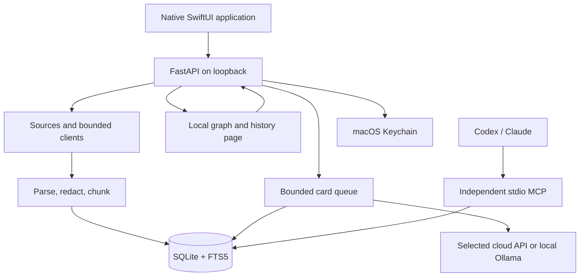

# Architecture

**Version 0.1.0 · updated 2026-11-06** · [Русский](architecture.ru.md) · [User guide](user-guide.en.md)

## Components and data flow

The native app owns its Python helper and selects a free loopback port. The HTTP layer validates loopback Host/Origin, applies CSRF checks to mutations, bounds requests, and adds security headers. This is a local-application boundary, not multi-user service authentication. Do not expose the port to a network.

The window and background process have different lifecycles: closing the window retains watching; quitting stops the app's owned service. MCP is separately launched by the AI client over stdio and does not depend on the application's HTTP port.

## Source map

| Area | Main files | Responsibility |
| --- | --- | --- |
| Native UI | `native/Sources/SecondBrain/`, `native/Sources/SecondBrainCore/` | Screens, request models, helper lifecycle, indicators, and user operations. |
| HTTP application | `brain_settings/app.py`, `security.py`, `memory_routes.py` | Application factory, local HTTP boundary, settings and memory endpoints. |
| Settings and secrets | `storage.py`, `source_storage.py`, `sources.py`, `service.py` | Atomic JSON persistence, Keychain, source configuration and access checks. |
| Source policy — unreleased | `source_policy.py`, `source_policy_routes.py` | SQLite permissions and exclusions, preview, and policy predicates shared by import, retrieval and model processing. |
| Local import | `importers.py`, `import_batch.py`, `session_stream.py`, `dialogue_parsers.py` | Bounded scanning, streaming reads, supported formats, and chunking. |
| Remote sources | `notion_*.py`, `github_*.py`, `mail_*.py` | Bounded read clients, material conversion, and durable import progress. |
| Storage and retrieval | `memory_store.py`, `memory_browse.py`, `memory_atlas.py`, `memory_text.py` | SQLite, FTS5/BM25, page cursors, graph snapshots, and redaction. |
| Automation | `background.py`, `memory_service.py`, `card_parallel.py`, `card_retries.py`, `provider_backoff.py` | Watching, writer ownership, batches, concurrency, retries, and durable provider admission pauses. |
| Model calls | `llm_cards.py`, `providers.py`, `transport.py`, `ollama.py` | Cloud provider settings, bounded public HTTPS and fixed-loopback Ollama calls, card and evidence validation. |
| MCP | `mcp_server.py`, `mcp_config.py`, `scripts/mcp-server.command` | Four read tools and client-configuration generation. |
| Graph and compatible web UI | `static/` | Local assets without CDNs; the browser graph is separate from native settings. |

## Portable runtime and development builds

The release ZIP contains a native executable and a frozen Python helper at
`Contents/Resources/Backend/SecondBrainHelper`. The native app prefers this helper
and invokes `serve` on its owned loopback port; an MCP client invokes the same
helper with `mcp`. The helper includes its interpreter, dependencies and local
static assets. End users do not need a checkout, `.venv`, Python or Xcode.

Release data defaults to `~/Library/Application Support/Second Brain`, outside
the signed bundle. `SECOND_BRAIN_DATA_DIR` can select an explicit data directory
for an isolated run. Source builds retain their checkout-local `.data` and
Python-launch path. These archives are separate; packaging does not migrate or
include private state. MCP configuration is generated from the running mode and
the selected data directory. Moving a release app requires updating the client's
absolute helper path.

Build and artifact checks are described in [releasing](releasing.md). The current
ZIP is ad-hoc signed; a portable runtime is separate from Developer ID signing
and Apple notarization.

## Model connections

**Updated 2026-11-05.** `qwen` is a cloud preset for Alibaba Cloud's Singapore OpenAI-compatible endpoint. It uses a region-matched Keychain token and the native `/api/v1/models` catalog. `ollama` is a separate credential-free connection to the fixed `127.0.0.1:11434` service. Its adapter discovers downloaded models through `/api/tags`, rejects remote/cloud models, and uses native `/api/chat` with an explicit local model qualifier; no cloud fallback is provided. The native response is normalized into the existing card-validation path, with exact source evidence and usage metadata.

Local requests use JSON format, disable thinking output, request a 16,384-token context and up to 1,024 output tokens, and have bounded timeouts. Effective local concurrency is one while the saved target remains unchanged. Provider status reports local execution separately from a temporary provider cooldown. Database search and the MCP tools are unchanged. Local Ollama and model weights are external installations, not part of the release ZIP.

## Persistence model

A source defines an import and visibility scope. A material stores a stable ID, source-object identifier, text, source/URI, timestamps, content hash, and current revision. Replacing one object's chunks is transactional. Unchanged text does not generate a new card; changed text creates a revision and resets its processing state.

FTS5 indexes text and retrieval fields, with BM25 ranking. Reads use bounded snippets and paginated cursors. The graph uses a snapshot of up to 2000 materials. All source/topic relationships are retained in batched SVG paths; keyed nodes and snapshot-scoped search indexes avoid rebuilding unchanged scenes, while camera writes are coalesced to animation frames. The database retains the current revision rather than every historical text version.

Card status and retry budgets are durable SQLite state. Automatic processing uses bounded claims and revision checks; concurrent API calls do not become independent, unsynchronized database writers. A writer lease prevents two import processes from owning the queue simultaneously. Deleted sources have tombstones that block late commits from work already in flight.

Provider pauses are separate SQLite state scoped by a hash of provider, normalized API address, and model, without credentials or request payloads. A `429` stops further card admission and temporarily lowers effective concurrency to one; successful requests restore it toward the configured value. `Retry-After` controls temporary waits, while recognized balance/key-budget errors require explicit resumption. The pause is checked again before sending a model request. An unsent request does not consume a record attempt; a sent failure does. Resuming a provider changes neither historical record budgets nor source-import and MCP availability. Card diagnostics retain safe categories and usage metadata rather than raw model/provider responses; evidence validation remains exact.

Local, GitHub, and email checkpoints retain import continuation. Mail uses UIDVALIDITY, bounded UID windows, and a persisted date scope. Pausing a mailbox retains existing materials: permission for new reads is separate from cache visibility in the app and MCP.

## Source policy in unreleased builds

Connection configuration remains in `sources.json`; source permissions and
exclusions are authoritative SQLite state. Compatible migrations add
`source_policies`, `source_exclusions`, and a Notes folder identifier on materials.
A missing policy permits each of the five scopes to preserve legacy behavior;
outer source-enabled and mailbox-import gates remain in force. This migration
does not configure a model or enable paid work.

The independent scopes are import, local retrieval, MCP retrieval, local model
processing and external model processing. Central SQL predicates filter before
ranking and apply to direct reads, browse/graph, brief and aggregate statistics,
including their timestamps. Updated independent MCP processes read current
policy from the same database rather than caching startup permissions. Older
server binaries must be restarted after upgrading.

Exclusions match a local file/subtree or an explicitly selected Notes folder.
Records with legacy opaque paths or unknown Notes folders are conservatively
hidden when their scope cannot be checked. The native preview counts affected
cached records and returns at most 20 examples. Exclusions leave originals alone
and prevent active retrieval, import and model processing; retained database
pages and backups are not an erasure guarantee.

Model admission checks the current provider-specific permission, and card saving
checks policy and revision inside its write transaction. Revocation cannot
cancel a disclosure that already occurred. MCP visibility remains a separate
recipient decision: local card processing does not make an agent's own model
local. There is no verified per-client identity or project authorization layer.

## Trust boundaries

- Sources are untrusted data, including instructions, inaccurate claims, and potential secrets. They must not become agent commands.
- HTTPS clients bound destinations and responses; validated public IPs are pinned for TLS connections. Notion/GitHub use fixed APIs; mail uses read-only IMAP over TLS.
- Known secret patterns are redacted before persistence and model processing. This is a heuristic, not a guarantee that all sensitive content is removed.
- A cloud model provider becomes a separate recipient of text when cloud card generation is permitted. The named Ollama adapter instead uses a downloaded model at its fixed local endpoint; the OS and server must be trusted. Local search does not call either model.
- Keychain stores secrets. JSON settings and SQLite can contain private metadata and are not encrypted by the application.
- MCP is limited to search and reads, but a client granted access can retrieve private materials. This mechanism does not isolate other processes running as the same user.

See [SECURITY.md](../SECURITY.md) for the threat model and limitations, and [CONTRIBUTING.md](../CONTRIBUTING.md) for development checks.
