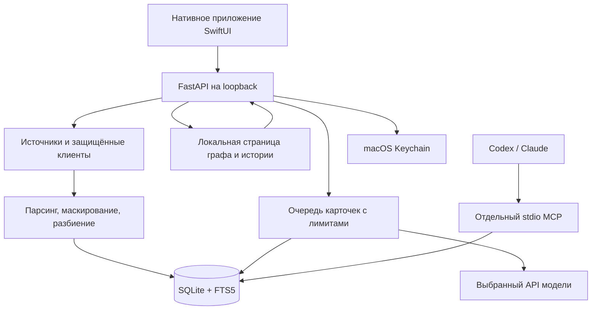

# Архитектура

**Версия 0.1.0 · обновлено 2026-11-04** · [English](architecture.en.md) · [Руководство](user-guide.ru.md)

## Компоненты и поток данных

Нативное приложение владеет своим Python-процессом и выбирает свободный loopback-порт. HTTP-слой проверяет loopback Host/Origin, CSRF для изменяющих операций, размер запросов и выдаёт защитные заголовки. Это защита локального приложения, а не аутентификация многопользовательского сервиса. Не публикуйте порт в сеть.

Окно и фоновый процесс приложения имеют разный жизненный цикл: закрытие окна сохраняет отслеживание; полный выход останавливает принадлежащую приложению службу. MCP запускается независимо самим клиентом и использует stdio, а не HTTP-порт приложения.

## Карта исходников

| Область | Основные файлы | Назначение |
| --- | --- | --- |
| Нативный UI | `native/Sources/SecondBrain/`, `native/Sources/SecondBrainCore/` | Окна, модели запросов, управление службой, индикация и операции пользователя. |
| HTTP-приложение | `brain_settings/app.py`, `security.py`, `memory_routes.py` | Фабрика приложения, локальная граница HTTP, API настроек и памяти. |
| Настройки и секреты | `storage.py`, `source_storage.py`, `sources.py`, `service.py` | Атомарная запись JSON, Keychain, настройка источников и проверки доступа. |
| Локальный импорт | `importers.py`, `import_batch.py`, `session_stream.py`, `dialogue_parsers.py` | Безопасный обход, потоковое чтение, поддерживаемые форматы и разбиение. |
| Удалённые источники | `notion_*.py`, `github_*.py`, `mail_*.py` | Ограниченные клиенты чтения, преобразование в материалы, продолжение импорта. |
| База и поиск | `memory_store.py`, `memory_browse.py`, `memory_atlas.py`, `memory_text.py` | SQLite, FTS5/BM25, курсоры страниц, граф и маскирование. |
| Автоматизация | `background.py`, `memory_service.py`, `card_parallel.py`, `card_retries.py`, `provider_backoff.py` | Отслеживание, общий писатель, партии карточек, параллелизм, повторы и сохраняемые паузы провайдера. |
| Модель | `llm_cards.py`, `providers.py`, `transport.py` | Конфигурация провайдера, ограниченные HTTPS-запросы, проверка карточки и доказательств. |
| MCP | `mcp_server.py`, `mcp_config.py`, `scripts/mcp-server.command` | Четыре инструмента чтения и генерация конфигурации клиента. |
| Граф и совместимый web UI | `static/` | Локальные ресурсы без CDN; браузерная страница графа отделена от нативных настроек. |

## Переносимый runtime и сборка для разработки

ZIP выпуска содержит нативный исполняемый файл и замороженный Python-сервис
`Contents/Resources/Backend/SecondBrainHelper`. Нативное приложение предпочитает
этот сервис и запускает `serve` на своём loopback-порту; MCP-клиент вызывает тот
же сервис с `mcp`. В него включены интерпретатор, зависимости и локальные
статические ресурсы. Пользователю не нужны исходники, `.venv`, Python или Xcode.

Данные готового выпуска по умолчанию находятся вне подписанного пакета в
`~/Library/Application Support/Second Brain`. `SECOND_BRAIN_DATA_DIR` позволяет
задать отдельную папку для изолированного запуска. Сборка из исходников сохраняет
проектную `.data` и запуск через Python. Эти архивы разделены: упаковка не
переносит и не включает личное состояние. Конфигурация MCP формируется по режиму
запуска и выбранной папке данных. После переноса готового приложения обновите
абсолютный путь сервиса в MCP-клиенте.

Сборка и проверки артефактов описаны в [инструкции выпуска](releasing.md).
Текущий ZIP имеет ad-hoc подпись; переносимый runtime не означает наличие
Developer ID или нотарификации Apple.

## Модель хранения

Источник задаёт область разрешённого импорта и видимости. Материал содержит стабильный ID, идентификатор объекта источника, текст, источник/URI, даты, хеш содержимого и текущую ревизию. Замена частей одного объекта выполняется транзакционно. Неизменённый текст не создаёт новую карточку; изменённый получает новую ревизию и сбрасывает связанное состояние обработки.

FTS5 индексирует тексты и поисковые данные, BM25 ранжирует совпадения. Для чтения есть ограниченные фрагменты и постраничные курсоры. Граф использует ограниченный снимок до 2000 материалов. База хранит текущую ревизию, а не полные копии всех исторических текстов.

Статус карточки и бюджет повторов находятся в SQLite. Автоматическая обработка использует ограниченные claims с проверкой ревизии; параллельные API-запросы не означают независимые несогласованные записи в базу. Lease писателя не позволяет двум процессам импорта одновременно владеть очередью. Удалённый источник помечается tombstone, который блокирует позднюю запись уже начатого задания.

Пауза провайдера — отдельное состояние SQLite, связанное с хешем провайдера, нормализованного адреса API и модели, без credentials и содержимого запросов. Ответ `429` останавливает допуск карточек и временно снижает фактическую параллельность до одного запроса; успешные запросы восстанавливают её до заданного значения. `Retry-After` задаёт временное ожидание, а распознанные ошибки баланса/бюджета ключа требуют явного возобновления. Проверка паузы повторяется непосредственно перед запросом модели. Неотправленный запрос не расходует попытку материала; отправленная неудача расходует. Возобновление провайдера не меняет бюджеты прошлых ошибок и доступность импорта или MCP. Диагностика карточек сохраняет безопасные категории и usage вместо полных ответов модели/провайдера; проверка доказательств остаётся точной.

Контрольные точки локального, GitHub- и почтового импорта сохраняют продолжение. Почта использует UIDVALIDITY, ограниченные окна UID и сохранённый период. Включение/пауза почтового импорта не удаляет материалы: разрешение новых чтений отделено от видимости кеша в приложении и MCP.

## Границы доверия

- Выбранные источники содержат недоверенные данные, включая инструкции, ошибочную информацию и потенциальные секреты. Их нельзя превращать в команды для агента.
- HTTPS-клиенты ограничивают назначения и ответы; проверенные публичные IP закрепляются для TLS-соединений. Notion/GitHub используют фиксированные API; почта — IMAP по TLS только для чтения.
- Маскирование известных шаблонов выполняется перед сохранением текста и модельной обработкой. Это эвристика, не средство доказанного удаления всех чувствительных сведений.
- Модель — отдельный внешний получатель текста при разрешённом создании карточек. Локальный поиск не вызывает модель.
- Keychain хранит секреты; JSON-настройки и SQLite могут содержать личные метаданные и не шифруются самим приложением.
- MCP ограничен поиском и чтением, но клиент с доступом к нему способен извлекать приватные материалы. Локальные процессы того же пользователя не изолируются этим механизмом.

См. [SECURITY.md](../SECURITY.md) для модели угроз и ограничений, [CONTRIBUTING.md](../CONTRIBUTING.md) — для разработки и проверок.
