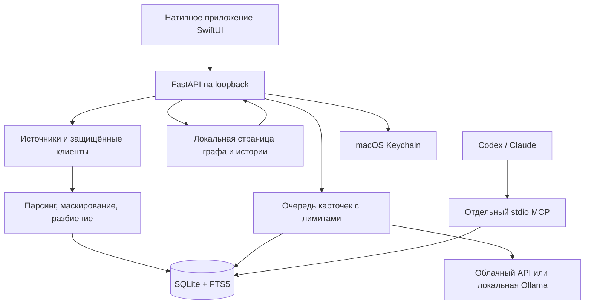

# Архитектура

**Версия 0.1.0 · обновлено 2026-11-06** · [English](architecture.en.md) · [Руководство](user-guide.ru.md)

## Компоненты и поток данных

Нативное приложение владеет своим Python-процессом и выбирает свободный loopback-порт. HTTP-слой проверяет loopback Host/Origin, CSRF для изменяющих операций, размер запросов и выдаёт защитные заголовки. Это защита локального приложения, а не аутентификация многопользовательского сервиса. Не публикуйте порт в сеть.

Окно и фоновый процесс приложения имеют разный жизненный цикл: закрытие окна сохраняет отслеживание; полный выход останавливает принадлежащую приложению службу. MCP запускается независимо самим клиентом и использует stdio, а не HTTP-порт приложения.

## Карта исходников

| Область | Основные файлы | Назначение |
| --- | --- | --- |
| Нативный UI | `native/Sources/SecondBrain/`, `native/Sources/SecondBrainCore/` | Окна, модели запросов, управление службой, индикация и операции пользователя. |
| HTTP-приложение | `brain_settings/app.py`, `security.py`, `memory_routes.py` | Фабрика приложения, локальная граница HTTP, API настроек и памяти. |
| Настройки и секреты | `storage.py`, `source_storage.py`, `sources.py`, `service.py` | Атомарная запись JSON, Keychain, настройка источников и проверки доступа. |
| Политики источников — ещё не выпущено | `source_policy.py`, `source_policy_routes.py` | Разрешения и исключения в SQLite, предпросмотр и общие проверки импорта, чтения и модельной обработки. |
| Локальный импорт | `importers.py`, `import_batch.py`, `session_stream.py`, `dialogue_parsers.py` | Безопасный обход, потоковое чтение, поддерживаемые форматы и разбиение. |
| Удалённые источники | `notion_*.py`, `github_*.py`, `mail_*.py` | Ограниченные клиенты чтения, преобразование в материалы, продолжение импорта. |
| База и поиск | `memory_store.py`, `memory_browse.py`, `memory_atlas.py`, `memory_text.py` | SQLite, FTS5/BM25, курсоры страниц, граф и маскирование. |
| Локальные embeddings — ещё не выпущено | `embedding_store.py`, `embeddings.py`, `retrieval.py` | Поколения индекса в SQLite, ограниченная фоновая индексация, точный векторный поиск и общий retrieval/RRF. |
| Доказательства и происхождение — ещё не выпущено | `evidence.py`, `evidence_pack.py`, `evidence_passages.py`, `retrieval_filters.py`, `source_dates.py`, `session_metadata.py` | Пакеты точных цитат, фильтры до ранжирования и явные даты/проект источника. |
| Факты и история — ещё не выпущено | `memory_facts.py`, `fact_schema.py`, `fact_queries.py`, `fact_relations.py`, `facts_service.py` | Проекция точных атомов карточек, снимки подтверждений ревизий, консервативные связи и постраничное чтение с политиками. |
| Автоматизация | `background.py`, `memory_service.py`, `card_parallel.py`, `card_retries.py`, `provider_backoff.py` | Отслеживание, общий писатель, партии карточек, параллелизм, повторы и сохраняемые паузы провайдера. |
| Модель | `llm_cards.py`, `providers.py`, `transport.py`, `ollama.py` | Облачные настройки, ограниченные публичные HTTPS-запросы и фиксированный loopback-клиент Ollama, проверка карточки и доказательств. |
| MCP | `mcp_server.py`, `mcp_config.py`, `scripts/mcp-server.command` | Четыре прежних инструмента и новые доказательства/факты/история (всего семь), генерация конфигурации клиента. |
| Граф и совместимый web UI | `static/` | Локальные ресурсы без CDN; браузерная страница графа отделена от нативных настроек. |

## Переносимый runtime и сборка для разработки

ZIP выпуска содержит нативный исполняемый файл и замороженный Python-сервис
`Contents/Resources/Backend/SecondBrainHelper`. Нативное приложение предпочитает
этот сервис и запускает `serve` на своём loopback-порту; MCP-клиент вызывает тот
же сервис с `mcp`. В него включены интерпретатор, зависимости и локальные
статические ресурсы. Пользователю не нужны исходники, `.venv`, Python или Xcode.

Данные готового выпуска по умолчанию находятся вне подписанного пакета в
`~/Library/Application Support/Second Brain`. `SECOND_BRAIN_DATA_DIR` позволяет
задать отдельную папку для изолированного запуска. Сборка из исходников сохраняет
проектную `.data` и запуск через Python. Эти архивы разделены: упаковка не
переносит и не включает личное состояние. Конфигурация MCP формируется по режиму
запуска и выбранной папке данных. После переноса готового приложения обновите
абсолютный путь сервиса в MCP-клиенте.

Сборка и проверки артефактов описаны в [инструкции выпуска](releasing.md).
Текущий ZIP имеет ad-hoc подпись; переносимый runtime не означает наличие
Developer ID или нотарификации Apple.

## Подключения моделей

**Обновлено 2026-11-05.** `qwen` — облачная преднастройка OpenAI-совместимого API Alibaba Cloud в Сингапуре. Она использует региональный токен в Keychain и собственный каталог `/api/v1/models`. `ollama` — отдельное подключение без credentials к фиксированному сервису `127.0.0.1:11434`. Адаптер получает загруженные модели через `/api/tags`, отклоняет удалённые/облачные модели и обращается к `/api/chat` с явным локальным квалификатором модели, без перехода к облаку. Нативный ответ преобразуется для существующей проверки карточек, точных цитат и usage.

Локальные запросы карточек используют JSON, выключают thinking-вывод, запрашивают
контекст 16 384 токена и до 1 024 выходных токенов; время ожидания ограничено.
Фактическая локальная параллельность равна одному запросу, сохранённое значение
не меняется. Статус провайдера отличает локальную обработку от паузы облачного
сервиса. Ollama и веса устанавливаются отдельно и не входят в ZIP выпуска.

В неопубликованной сборке embeddings используют отдельную явно включаемую
настройку и установленную модель, не меняя провайдера карточек. Адаптер фиксированного
loopback проверяет локальность и digest, поддержку embeddings и размерность;
вызывает `/api/embed` с `truncate: false`. Веса не загружаются, облачной подмены нет.
Ввод — заголовок, перевод строки и сохранённый текст; длина более 12 000 символов
приводит к явной ошибке индексации, при этом BM25 остаётся доступен.

## Локальный поиск в неопубликованной сборке

HTTP и stdio MCP используют общий `Retrieval`. Режимы — `lexical` (по умолчанию),
`semantic` и `hybrid`. Лексический поиск не вызывает модель; два остальных режима
могут создать вектор запроса явно включённой локальной моделью. На запрос выделен
трёхсекундный срок, при ошибке сохраняется BM25 с диагностикой `requested_mode`,
`used_mode`, `fallback_reason`. `eligible`, `ready`, `partial` описывают покрытие
разрешённого корпуса. Частичный семантический индекс ищет только готовые векторы;
гибридный дополнительно использует BM25 по всему разрешённому корпусу.
Выключенный/пустой индекс возвращает BM25 до допуска запроса модели.

Векторные кандидаты независимы от лексических. Первая реализация точно сканирует
нормализованные векторы SQLite порциями по 128 строк и сохраняет ограниченную кучу
лучших кандидатов; расширения SQLite и отдельный векторный сервер не загружаются.
Гибридное ранжирование использует RRF с равными весами и `k=60` вместо сложения
BM25 и cosine. Оценки показывают порядок релевантности, а не истинность. Настройка
на настоящей модели и необходимое улучшение пересказов пока не подтверждены.

Идентичность индекса включает модель/digest, размерность и версию подготовки;
при смене создаётся новое поколение. Вектор привязан к ревизии и хешу материала.
Один фоновый писатель приложения индексирует возобновляемые ограниченные пакеты
с проверкой паузы и разрешения локальной обработки. MCP читает готовые векторы
и может создать вектор запроса. При сохранении/чтении проверяются ревизия,
поколение и политика. См. [контракты и результаты измерений](search-contracts.md).

## Модель хранения

Метаданные доказательств неопубликованной сборки разделяют nullable `message_at`,
`source_created_at`, `source_modified_at`, `imported_at`. Старые неоднозначные даты
остаются неизвестными, а не выводятся из полей свежести. `imported_at` — сохранение
текущей текстовой ревизии, не каждый неизменённый проход. Явный повторный импорт
может обновить метаданные источника без смены неизменённой текстовой ревизии.
`project` переносится из ограниченных явных `cwd`/`project` метаданных сессии через
парсер и чанки; путь файла, заголовок и обход файловой системы не создают проект.

| Материал | Явные даты доказательств |
| --- | --- |
| Файл локальной папки | mtime как изменение источника; без выдуманного сообщения/создания |
| Чанк сессии | Последнее сообщение чанка, если дата корректна |
| IMAP-письмо | Только Date с часовым поясом |
| Outlook-письмо | Получение как дата сообщения; изменение только при наличии |
| Notion / Apple Заметки | Предоставленные источником создание/изменение |
| GitHub issue / PR | Создание/изменение самого объекта |
| Файл GitHub | Даты неизвестны, если объект их не даёт; даты репозитория не подставляются |

Источник задаёт область разрешённого импорта и видимости. Материал содержит стабильный ID, идентификатор объекта источника, текст, источник/URI, даты, хеш содержимого и текущую ревизию. Замена частей одного объекта выполняется транзакционно. Неизменённый текст не создаёт новую карточку; изменённый получает новую ревизию и сбрасывает связанное состояние обработки.

FTS5 индексирует тексты и поисковые данные, BM25 ранжирует совпадения. Для чтения есть ограниченные фрагменты и постраничные курсоры. Граф использует ограниченный снимок до 2000 материалов. Все связи источников и тем сохраняются в пакетных SVG-контурах; узлы переиспользуются, поисковый индекс строится на снимок, неизменившаяся сцена не пересоздаётся, а движение камеры объединяется по кадрам. Основные материалы хранят текущую ревизию. Неопубликованная история фактов отдельно сохраняет участвующие ревизии подтверждений с момента включения функции; это не полный архив всех прежних текстов источника.

Статус карточки и бюджет повторов находятся в SQLite. Автоматическая обработка использует ограниченные claims с проверкой ревизии; параллельные API-запросы не означают независимые несогласованные записи в базу. Lease писателя не позволяет двум процессам импорта одновременно владеть очередью. Удалённый источник помечается tombstone, который блокирует позднюю запись уже начатого задания.

Пауза провайдера — отдельное состояние SQLite, связанное с хешем провайдера, нормализованного адреса API и модели, без credentials и содержимого запросов. Ответ `429` останавливает допуск карточек и временно снижает фактическую параллельность до одного запроса; успешные запросы восстанавливают её до заданного значения. `Retry-After` задаёт временное ожидание, а распознанные ошибки баланса/бюджета ключа требуют явного возобновления. Проверка паузы повторяется непосредственно перед запросом модели. Неотправленный запрос не расходует попытку материала; отправленная неудача расходует. Возобновление провайдера не меняет бюджеты прошлых ошибок и доступность импорта или MCP. Диагностика карточек сохраняет безопасные категории и usage вместо полных ответов модели/провайдера; проверка доказательств остаётся точной.

Контрольные точки локального, GitHub- и почтового импорта сохраняют продолжение. Почта использует UIDVALIDITY, ограниченные окна UID и сохранённый период. Включение/пауза почтового импорта не удаляет материалы: разрешение новых чтений отделено от видимости кеша в приложении и MCP.

## Пакеты доказательств в неопубликованной сборке

`EvidenceService` обслуживает `GET /api/memory/evidence` и MCP
`get_evidence_bundle` только для чтения. Источник, точное сохранённое значение
проекта и UTC-даты фильтруются до получения BM25/векторных кандидатов. Приоритет
дат — сообщение, изменение источника, создание; бездатные материалы не проходят
фильтр, время импорта не участвует. Текущие цитаты и покрытие проверяются в одном
снимке чтения по ревизии, метаданным и политике источника.

Фрагменты текста и сохранённые доказательства карточек дают точные диапазоны
Unicode codepoints и устойчивые ID. Упаковка чередует источники, объединяет равные
цитаты с ограниченными дополнительными подтверждениями и ограничивает компактный
JSON-пакет 2 000–32 000 символов вместе с метаданными, по умолчанию 12 000.
Неполнота указывается явно; ответ не генерируется. Создание карточек и платная
модель не запускаются; выбранный режим может использовать явно включённые
локальные embeddings запроса. Нативное окно показывает цитаты, позволяет повторную
проверку и копирует JSON только явно. Перед копированием полный запрос повторяется
с текущей политикой, включая подтверждения дублей и агрегаты; пустой/ошибочный
или устаревший ответ не меняет буфер. Проверка/открытие также обновляют пакет и
перечитывают разрешённый материал с проверкой ID, URI, типа, ревизии и диапазона.
Копирование URI из деталей тоже перечитывает запись. Уже показанный/возвращённый
текст отозвать нельзя. HTTPS открывается в браузере, локальный файл
показывается в Finder, непрозрачный Notes ID остаётся идентификатором.

Фрагмент без локализованного подтверждения запроса или с неоднозначным
доказательством карточки получает `quote_relevance="uncertain"` и явную причину
неполноты. Интерфейс показывает понятные подписи, JSON сохраняет исходную диагностику.

## Факты и история решений в неопубликованной сборке

`fact_schema` добавляет сущности, снимки ревизий, подтверждения, связи и отметки
проекции. Идентичность включает тип и точную формулировку после Unicode NFC и
удаления внешних пробелов. Материалы и разрешённые подтверждения сохраняются;
похожесть не доказывает равенство/конфликт. Новые проверенные карточки проецируются
в транзакции сохранения. Готовые старые карточки обрабатываются ограниченными
заданиями единого писателя: вручную по умолчанию 100 (1–500), в том числе при паузе;
автоматическая проекция соблюдает паузу. Чтение MCP не проецирует карточки и не
запускает модель. Промпт/схема 3 добавляет необязательные связи в прежний запрос
карточки с сохранением провайдера, очереди и бюджета попыток.

`source_supported` — точное цитатное подтверждение, не истинность. Распознанное
обрамление отрицания/предложения/примера/кода оставляет кандидата. `possible_conflict`
— предложение проверки; `explicit_supersedes` требует узкой положительной
направленной формулировки с обоими утверждениями и проверенным контекстом.
Новая дата сама по себе не меняет связь или истинность. Ревизия перепроверяет
цитату и её обрамление; утраченное подтверждение не выдаётся действующим.

`get_facts`/HTTP ищут подстроку без учёта регистра в объединённых формулировках.
По умолчанию нужно действующее разрешённое подтверждение. Явное
`include_history=true` дополнительно находит только прошлые формулировки с
неактивными подтверждениями, статусом кандидата и `historical_only=true`.
`get_fact_history`/HTTP возвращают устойчивые `event_id` и страницы `next_cursor`/
`before`. `observed_at`, `history_since` — время наблюдений функции, отдельно от
дат источника; отсутствовавшие старые версии не восстанавливаются. Применяются
политики снимка и текущего материала, цели связей допускаются до лимитов.
Удаление источника убирает его производные подтверждения/снимки; скрытие/исключение
блокирует чтение без обещания стирания старых резервных копий.

Компактный JSON ограничен 32 000 байтами UTF-8 с явными флагами усечения
подтверждений/связей/списка. Нативные окна показывают группы, пометки прошлых
формулировок и постраничные наблюдения, обновляют доступ перед действием и
отличают исторический снимок от текущего материала. См. [контракты](search-contracts.md).

## Политики источников в неопубликованной сборке

Настройки подключений остаются в `sources.json`; авторитетное состояние разрешений
и исключений находится в SQLite. Совместимые миграции добавляют `source_policies`,
`source_exclusions` и идентификатор папки Notes у материала. Отсутствующая политика
разрешает все пять областей ради сохранения прежнего поведения; общий флаг
источника и отдельный переключатель импорта почты продолжают действовать.
Миграция не настраивает модель и не включает платную обработку.

Независимые области — импорт, локальное чтение, MCP, локальная и внешняя модельная
обработка. Общие SQL-предикаты фильтруют до ранжирования, применяются к прямому
чтению, спискам/графу, сводке и статистике, включая её даты. Обновлённые независимые
MCP-процессы читают действующую политику из одной базы, не кешируя права при старте.
Старые серверные процессы после обновления нужно перезапустить.

Исключения сопоставляются с локальным файлом/поддеревом или явно выбранной папкой
Notes. Старые записи с непрозрачным путём или неизвестной папкой Notes скрываются,
когда область нельзя проверить. Нативный предпросмотр считает затронутые материалы
кеша и возвращает до 20 примеров. Исключения сохраняют оригиналы и блокируют
активное чтение, импорт и модельную обработку; это не гарантия стирания страниц
базы или резервных копий.

Перед отправкой модели проверяется актуальное разрешение для выбранного режима;
сохранение карточки проверяет политику и ревизию внутри транзакции записи.
Отзыв разрешения не отменяет уже состоявшуюся передачу. Видимость MCP остаётся
отдельным решением о получателе: локальные карточки не делают модель агента
локальной. Проверяемой идентичности клиентов и отдельных проектных прав нет.

## Границы доверия

- Выбранные источники содержат недоверенные данные, включая инструкции, ошибочную информацию и потенциальные секреты. Их нельзя превращать в команды для агента.
- HTTPS-клиенты ограничивают назначения и ответы; проверенные публичные IP закрепляются для TLS-соединений. Notion/GitHub используют фиксированные API; почта — IMAP по TLS только для чтения.
- Маскирование известных шаблонов выполняется перед сохранением текста и модельной обработкой. Это эвристика, не средство доказанного удаления всех чувствительных сведений.
- Облачная модель — отдельный внешний получатель текста при разрешённом создании облачных карточек. Именованный адаптер Ollama использует загруженную модель по фиксированному локальному адресу; ОС и сервер должны быть доверенными. Лексический поиск не вызывает модель; неопубликованные semantic/hybrid могут вызывать явно включённую локальную embedding-модель.
- Keychain хранит секреты; JSON-настройки и SQLite могут содержать личные метаданные и не шифруются самим приложением.
- MCP ограничен поиском и чтением, но клиент с доступом к нему способен извлекать приватные материалы. Локальные процессы того же пользователя не изолируются этим механизмом.

См. [SECURITY.md](../SECURITY.md) для модели угроз и ограничений, [CONTRIBUTING.md](../CONTRIBUTING.md) — для разработки и проверок.
